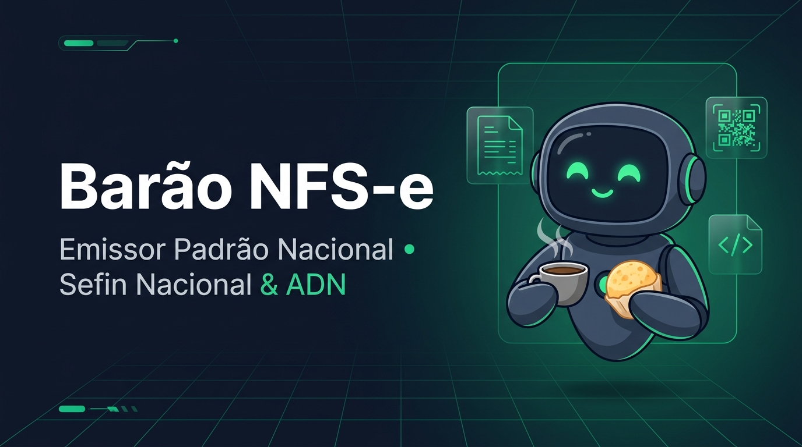

<p align="center">
  
</p>

<p align="center">
  
</p>

<h1 align="center">Barão NFS-e</h1>

<p align="center">
  <strong>Emissor local de Nota Fiscal de Serviço Eletrônica (NFS-e) no Padrão Nacional (Sefin Nacional / ADN)</strong><br />
  Feito com carinho mineiro, café passado na hora e pão de queijo quentinho — rodando 100% na sua máquina.
</p>

<p align="center">
  = 22" />
  
  
  
  
  
</p>

---

## Sobre o Projeto

O **Barão NFS-e** nasceu para eliminar planilhas, portais lentos e dependências de terceiros na hora de emitir **NFS-e no Padrão Nacional**. Ele assina a **DPS** com seu **Certificado Digital A1 (`.p12`/`.pfx`)**, transmite diretamente para a **Sefin Nacional** via **mTLS**, sincroniza notas emitidas e recebidas pelo **ADN (NSU)** e gera um **DANFSe v2.0 em PDF** limpo, executivo e com a logo da sua empresa.

---

## Principais Funcionalidades

- **Emissão Oficial (DPS → SEFIN Nacional):** suporte completo aos ambientes de **Homologação** e **Produção**, com assinatura XMLDSig (`xml-crypto`) e envio mTLS direto via OpenSSL 3.
- **DANFSe v2.0 em PDF (NT 008/2026):** geração local em página única A4 (`pdfkit` + `qrcode`) com logo da empresa, número/série/DPS, Chave de Acesso de 50 dígitos, QR Code e link clicável para a **Consulta Pública** (`nfse.gov.br`).
- **Sincronização com o ADN:** importa notas **emitidas** e **recebidas** contra o seu CNPJ via distribuição por NSU, mantendo o contador de DPS/NFS-e alinhado.
- **Templates & Placeholders Dinâmicos:** salve modelos recorrentes com dados bancários/PIX e variáveis automáticas de competência (`{{MMMM/AAAA}}`, `{{MMMM/AA}}`, `{{MM/AAAA}}`, `{{MM/AA}}`).
- **Gestão de Tomadores:** busca automática de CNPJ (BrasilAPI / CNPJ.ws / ReceitaWS) e base local de clientes.
- **Segurança & Privacidade Local:**
  - Servidor Fastify restrito a `127.0.0.1` com proteção anti-CSRF (`Host`/`Origin`).
  - Senha do Certificado A1 criptografada em repouso com **`AES-256-GCM`** (`data/.master.key`).
  - Separação estrita entre **Homologação** e **Produção** no SQLite.
- **UX Moderna:** interface React + Tailwind CSS v4 + **shadcn/ui** (`base-nova`), notificações padronizadas com **Sonner**, `ScrollArea` sobreposto e dicionário **i18n por domínios** (`web/src/i18n/`).

---

## Como funciona a validade fiscal (XML vs. PDF)

> Pela **Nota Técnica SE/CGNFS-e nº 008/2026**, a API pública do ADN para geração de PDF foi descontinuada e cabe aos sistemas emissores gerarem o DANFSe localmente.
>
> - **XML assinado:** é o único documento com validade fiscal e jurídica.
> - **PDF (DANFSe v2.0):** é a representação visual auxiliar para conferência e cobrança — validável a qualquer momento pelo **QR Code** ou pela **Chave de Acesso de 50 dígitos** na Consulta Pública do `nfse.gov.br`.

---

## Arquitetura

```text
barao-nfse/
├── docs/                     # Identidade visual do Barão (capa e logo)
├── scripts/                  # Instalação opcional como serviço macOS (launchd)
├── src/
│   ├── config/constants.js   # Endpoints SEFIN/ADN, códigos cTribNac/NBS e tabelas fiscais
│   ├── db/database.js        # SQLite nativo (node:sqlite) com repositórios isolados
│   ├── domain/               # Validação CPF/CNPJ e calculadora fiscal (ISSQN/retencões)
│   ├── infra/                # OpenSSL A1, XMLDSig, dpsXmlBuilder, sefinClient mTLS, danfsePdfGenerator
│   ├── routes/apiRoutes.js   # API REST Fastify + validação Zod
│   └── services/             # Orquestração de emissão, sincronização NSU e PDF
├── test/                     # Suíte node:test (certificado, SQLite, domínio/XML, PDF)
└── web/
    └── src/
        ├── i18n/pt-BR/       # Dicionários organizados por domínio (common, home, emitir, notas, cadastros)
        └── components/       # Páginas (Home, Notas), modais, wrappers shell e shadcn/ui
```

---

## Requisitos

- **Node.js** `>= 22` (usa `node:sqlite` nativo)
- **pnpm**
- **OpenSSL** (para leitura de certificados `.p12`/`.pfx`)

---

## Instalação e Uso

```bash
# 1. Instalar dependências
pnpm install

# 2. Gerar build do frontend
pnpm build

# 3. Iniciar o servidor local
pnpm start
```

Abra **`http://127.0.0.1:3333`** no navegador.

### Comandos úteis

| Comando | Descrição |
| --- | --- |
| `pnpm dev` | Roda API (`:3334`) e Vite (`:5173`) com hot-reload |
| `pnpm build` | Compila o frontend React para `public/` |
| `npm test` | Executa toda a suíte de testes (`node --test`) |
| `pnpm run service:install` | Instala como serviço em segundo plano no macOS (`launchd`) |

---

## Licença

Distribuído sob a licença **MIT**. Veja `package.json` para mais detalhes.
